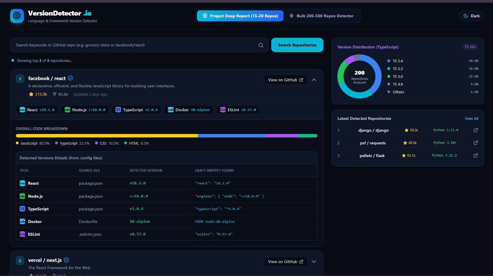
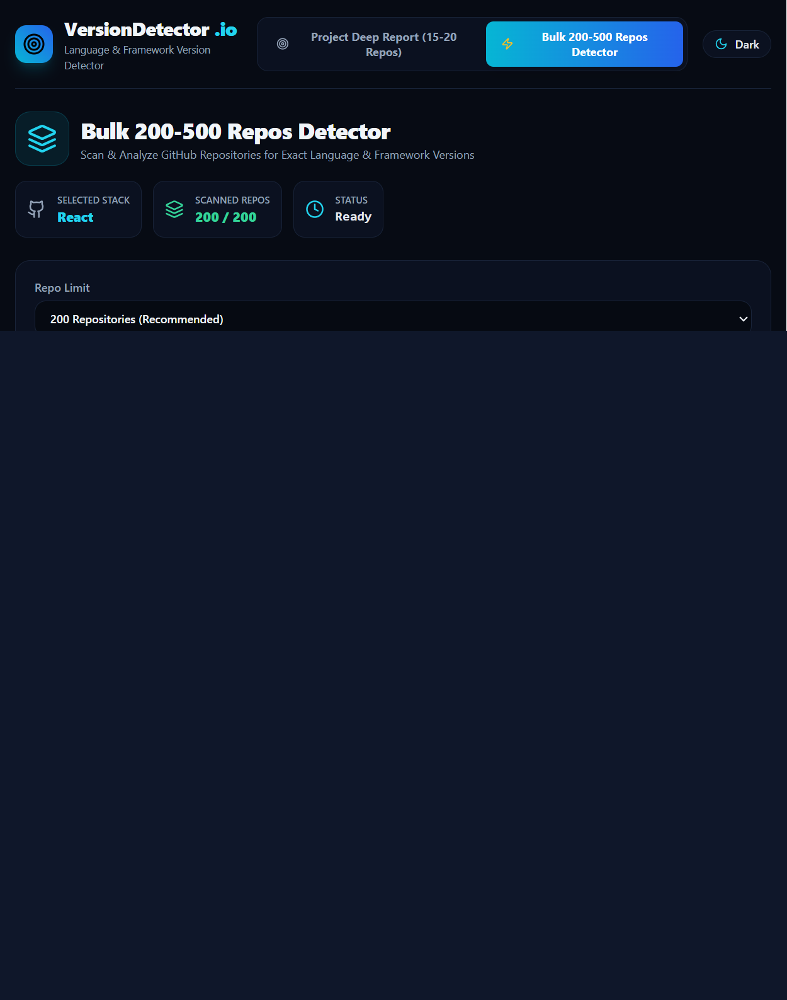

# 🔍 VersionDetector.io — Language & Framework Version Detector

[](https://reactjs.org/)
[](https://nodejs.org/)
[](https://tailwindcss.com/)
[](https://docs.github.com/en/rest)
[](LICENSE)

**VersionDetector.io** is a full-stack web application that analyzes public GitHub repositories and detects programming languages, runtimes, and framework versions.

Instead of relying solely on GitHub's high-level language bytes, **VersionDetector.io** inspects actual repository configuration files (`package.json`, `pyproject.toml`, `pom.xml`, `go.mod`, `composer.json`, `Dockerfile`, etc.) to provide detailed, line-by-line version breakdowns.

---

## 🚀 Run locally

### Backend (port 5000)

```bash
cd backend
npm ci
cp .env.example .env
# Optional but recommended for larger scans: set GITHUB_TOKEN in .env.
# Without a token, GitHub API rate limits are much lower.
npm run dev
```

### Frontend (port 3000)

```bash
cd frontend
npm ci
npm run dev
```

In development, Vite proxies `/api` to `http://localhost:5000`, so no extra
configuration is needed. For a production build (`npm run build`), serve the
frontend from the same origin as the backend, or set `VITE_API_BASE_URL` in
`frontend/.env` to the backend's URL (see `frontend/.env.example`).

### Tests (backend)

```bash
cd backend
npm test
```

The tests cover the pure helpers: version cleaning, direct-repo parsing, and
GitHub query mapping. There is no automated UI test suite yet.

---

## ✨ Features

### 🔬 1. Project Deep Report Mode (15–20 Repositories)
* **Keyword & Topic Search**: Search for specific project topics (e.g., `grocery store`, `e-commerce`, `machine learning`).
* **Direct Repository**: Enter a direct GitHub repository URL (e.g., `https://github.com/facebook/react`) or `owner/repo` (e.g., `facebook/react`) to analyze exactly that repository.
* **Exact Code Snippets**: Displays the exact configuration file source line (e.g., `"react": "18.2.0"`, `FROM node:20-alpine`, `<java.version>17</java.version>`).
* **Instant Versions Summary Row**: Badges displayed directly under project descriptions for instant visibility without opening details.
* **Code Percentage Distribution**: Multi-color bar showing language byte distribution.
* **Real update dates**: Each card shows the repository's actual last-update date from GitHub. No "verified" badge is shown, because GitHub provides no such flag for a repository.

### ⚡ 2. Bulk 200–500 Repos Detector Mode
* **Quick Preset Categories**: Categorized preset buttons for both **Frontend** (`JavaScript`, `TypeScript`, `HTML/CSS`, `React`, `Vue`, `Angular`) and **Backend** (`Python`, `Java`, `Node.js`, `Go`, `PHP`, `Ruby`, `C#`).
* **Flexible Repo Limits**: Select limits between `50`, `100`, `200`, or `300` repositories (the API clamps limits to 10–500).
* **Top 3 Most Used Versions Summary**: Automatically calculates and highlights the top 3 most frequently used versions with rank badges, repository counts, and percentages.
* **Dynamic Donut Chart**: Interactive Chart.js breakdown visualizing version distributions across all fetched repos.
* **1-Minute Auto-Updating Sidebar**: Live sidebar widget rotating popular language version stats every 60 seconds with an animated timer. The numbers are fetched live from the backend for each rotated language — they are not hardcoded.
* **Paginated Results Table**: Clean table layout with GitHub links, star counts, and custom version badges.

### 🎨 3. UI/UX Features
* **Dual Theme Mode**: Toggle smoothly between **Slate Dark Mode** and **Crisp Light Mode**.
* **Brand Color Badges**: Official brand colors for technologies (React Cyan, Node Green, Python Blue, Java Orange, Docker Sky Blue).
* **Responsive Dashboard**: Split 2-column layout built for all screen sizes.

---

## 🔌 API

Backend base URL: `http://localhost:5000` in development.

* `GET /api/analyze-single-repo?target=<keyword|owner/repo|github-url>&count=20`
  Keyword search returns up to `count` projects (1–100). A direct repo
  reference returns exactly that one project; `count` is ignored then.
* `GET /api/language-versions?lang=<language>&limit=200`
  Returns `{ cached, total, data }`, where each item has `name`, `url`,
  `stars`, `description`, and `detectedVersion`.

Errors are JSON: missing parameters return 400, an invalid GitHub search
query returns 400, a missing repository returns 404, GitHub rate limits
return 429, and unknown API routes return a JSON 404. Responses are cached
for 15 minutes. The API itself is rate-limited to 120 requests per IP per
minute by default (`API_RATE_LIMIT_PER_MINUTE` in `backend/.env`).

CORS is restricted to origins in `ALLOWED_ORIGINS` (default: local
development origins). Set it explicitly before deploying.

---

## 🛠️ Tech Stack

* **Frontend**: React 18, Tailwind CSS, Lucide React Icons, Chart.js (`react-chartjs-2`), Axios, Vite.
* **Backend**: Node.js, Express.js, Axios, NodeCache (In-memory caching with 15-min TTL), Dotenv.
* **API**: GitHub REST API v3.

---

## 📸 Screenshots





## 📂 Project Structure

```text
VersionDetector/
├── backend/
│   ├── .env.example
│   ├── package.json
│   ├── server.js               # Express server & API routes
│   ├── versionDetector.js      # Configuration file parsing logic
│   ├── repoAnalyzer.js         # Multi-repo deep inspection & snippet extraction
│   └── test/
│       └── helpers.test.js     # Unit tests for pure helpers (node --test)
├── frontend/
│   ├── .env.example
│   ├── vite.config.js          # Dev server on port 3000, /api proxy to backend
│   ├── src/
│   │   ├── api.js              # API base URL helper
│   │   ├── components/
│   │   │   ├── BulkDetectorDashboard.jsx  # Bulk 200-500 Repos Dashboard
│   │   │   ├── ProjectCardList.jsx         # Deep Report Accordion & Snippet Table
│   │   │   ├── SidebarPanel.jsx            # Live 1-min Version Overview
│   │   │   └── TechIcon.jsx                # Colorful Technology Brand Badges
│   │   ├── App.jsx                         # Main Header, Tabs & Theme Switcher
│   │   ├── index.css
│   │   └── main.jsx
│   ├── package.json
│   └── tailwind.config.js
├── screenshots/
├── LICENSE
└── README.md
```

---

## ⚠️ Known limitations

* Detection reads configuration files at the repository root (plus a few
  well-known files such as `.nvmrc`, `.java-version`, `Gemfile.lock`, and
  `build.gradle.kts`). Repos that keep configs in subdirectories, or that
  declare versions only in lockfiles, may return "Not specified".
* C# detection looks for `<repo>.csproj` at the root; a differently named
  project file will not be found.
* Bulk mode shows one detected version per repository (the first matching
  candidate in priority order). Deep mode shows the full detected stack.
* Placeholder version protocols such as pnpm `catalog:` and npm
  `workspace:` are treated as "not a real version" and skipped, rather than
  displayed as a version.
* Bulk scans of 200–500 repos make many GitHub API calls. Use a
  `GITHUB_TOKEN` for large scans, or results may hit GitHub rate limits.
